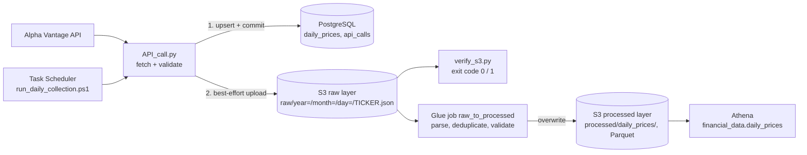

# Financial Data Platform


A batch data platform for daily stock prices, built step by step. An
idempotent collector pulls prices from the Alpha Vantage API into PostgreSQL
and keeps every raw response in an S3 data lake. A serverless Spark job on AWS
Glue turns the raw layer into a typed, de-duplicated Parquet table, which
Athena queries with SQL.

This repository is part of a data engineering portfolio series. The projects
build on each other, so they share one codebase; each finished stage is marked
with a git tag.

| Stage | Project | What it adds | Tag |
|---|---|---|---|
| 2 | Daily API collector | live API → PostgreSQL, idempotent upsert, quota tracking, tests | `v0.2-api-collector` |
| 3 | Data lake on S3 | raw layer in S3, least-privilege IAM, upload verification | `v0.3-data-lake` |
| 4 | Serverless ETL | Glue (Spark) job raw → processed Parquet, data quality gate, Athena, JSON vs Parquet measurement | `v0.4-serverless-etl` |
| 5 | Data warehouse | Redshift and Power BI *(next)* | |

Design rationale lives in the design docs:

- [`docs/design-doc.md`](docs/design-doc.md): collector (project 2)
- [`docs/data-lake-design.md`](docs/data-lake-design.md): data lake (project 3)
- [`docs/serverless-etl-design.md`](docs/serverless-etl-design.md): serverless ETL (project 4),
  with working notes in [`docs/p4-decision-log.md`](docs/p4-decision-log.md)

This README covers what the platform does and how to run it.

## Architecture



- **Collection (projects 2–3).** One collector run handles one ticker. A
  PowerShell wrapper, started by the Windows Task Scheduler on weekdays,
  collects five tickers and verifies each upload. Later runs on the same day
  only retry the tickers that are still missing.
- **Processing (project 4).** The Glue job reads every raw snapshot, turns the
  date-keyed JSON into one row per ticker and trading day, keeps the latest
  snapshot of each day, checks the data quality rules, and only then
  overwrites the processed layer with a single Parquet file.

## What It Demonstrates

- **Idempotency.** The PostgreSQL load is an upsert on `(ticker, trade_date)`;
  the Glue job rebuilds the processed layer from the full raw layer on every
  run. Re-running either step never creates duplicates.
- **Deterministic de-duplication.** Each raw file is a snapshot of about 100
  trading days, so consecutive files overlap. The job keeps exactly one row
  per ticker and day with `ROW_NUMBER`, latest snapshot first; never
  `dropDuplicates`, which keeps an arbitrary row.
- **Explicit schemas.** The trading days are JSON keys, not values. Inferring
  a schema (Glue Crawler or Spark) would create one column per date; the job
  reads them as a map and explodes it instead.
- **Data quality as a gate.** Empty input, NULLs, duplicate keys and
  inconsistent daily candles (`low <= open, close <= high`, positive prices,
  no future dates) stop the job before anything is written, so a bad run
  leaves the previous table intact.
- **Exact money values.** Prices are `DECIMAL(12,4)` in every layer, cast
  directly from the API's strings; `DOUBLE` is used only in calculations.
- **Measured, not assumed.** The same question on raw JSON and processed
  Parquet: 314x less data scanned, identical results (see below).
- **Least-privilege access.** Separate identities for collecting (IAM user,
  `raw/` only), processing (Glue role, `raw/` read and `processed/` write) and
  development (temporary console credentials).
- **Fault tolerance and observability.** Network retries with backoff, narrow
  exception handling, one log line per outcome, and exit codes a scheduler can
  act on.

## Key Design Decisions

| Decision | Rationale |
|---|---|
| Upsert (`ON CONFLICT ... DO UPDATE`), not delete-then-insert | atomic, race-condition-free, one round trip |
| Success judged by response *content* | a quota breach also returns `200 OK` and valid JSON |
| S3 upload after the database commit, best-effort | the primary load must not depend on S3 availability |
| S3 partitions by run date in UTC | the raw layer stores what was received and when |
| Collector exits with 1 when nothing was collected | a scheduler must not see an empty run as a success |
| One `daily_prices` table with a `ticker` column | new tickers need no change; comparisons are a `GROUP BY` |
| Explicit map schema, table registered by DDL, no crawler | a crawler would create one column per date and is not guaranteed to be stable |
| Full rebuild, single Parquet file, no partitions | a few MB of data; simple and self-healing; partitions only at several hundred MB |
| Strict data quality before the write | small financial data set; a failed run must not damage the table |
| Glue 6.0, local Spark in WSL2 with the same versions | fast, free test loop; native Windows could not run the PySpark workers |
| Athena workgroup with managed results and a 100 MB per-query limit | no results bucket; a runaway query is stopped |

The full list, with the alternatives considered, is in the design docs.

## Results: Raw JSON vs Processed Parquet

The same question ("trading days and average close per ticker") on both
layers in Athena, on 71 raw snapshots of five tickers:

| | Raw JSON | Processed Parquet |
|---|---|---|
| Stored size | 935.4 KB | 17.9 KB (about 52x smaller) |
| Data scanned per query | 935.44 KB | 2.98 KB (about 314x less) |
| Query | explode + window function + filter | one `GROUP BY` |
| Result | identical | identical |

Without de-duplication the raw query silently counts every day once per
snapshot (1,400 instead of 113 days per ticker). The de-duplicated raw query,
written independently in SQL, returns exactly the Glue job's numbers, which
cross-checks the job. Details: design doc section 8.1.

One Glue run (Glue 6.0, 2 x G.1X) takes about 2 minutes and 0.075 DPU-hours.

## Data Source

[Alpha Vantage](https://www.alphavantage.co/), free tier, `TIME_SERIES_DAILY`
endpoint (about 100 completed trading days per response). The free tier allows
25 requests per day and 5 per minute; the collector tracks the daily limit
itself, and the wrapper pauses between tickers.

## Prerequisites

- Python 3.14 (collector) and PostgreSQL 18.4
- An [Alpha Vantage API key](https://www.alphavantage.co/support/#api-key) (free)
- An AWS account: S3 buckets and IAM identities as in
  [`docs/data-lake-design.md`](docs/data-lake-design.md) (section 4) and
  [`docs/serverless-etl-design.md`](docs/serverless-etl-design.md) (sections 4.5–4.8)
- For the Spark tests: WSL2 (Ubuntu 24.04) with Python 3.13 and OpenJDK 17

## Installation

1. Clone the repository:
   ```bash
   git clone https://github.com/Maxid8/financial-data-platform.git
   cd financial-data-platform
   ```

2. Collector environment (Windows):
   ```powershell
   python -m venv .venv
   .venv\Scripts\Activate.ps1
   pip install -r requirements.txt
   ```

3. Create your `.env` file from the template and fill in the API key, the
   PostgreSQL credentials, the AWS credentials and the bucket name:
   ```bash
   cp .env.example .env
   ```

4. Create the database schema:
   ```bash
   psql -U your_user -d your_database -f sql/table.sql
   ```

5. Spark environment for the project 4 tests (WSL2); the steps are listed at
   the top of [`requirements-spark.txt`](requirements-spark.txt):
   ```bash
   python3.13 -m venv ~/.venvs/spark && source ~/.venvs/spark/bin/activate
   pip install -r requirements-spark.txt
   ```

**Behind a TLS-inspecting corporate proxy:** boto3 does not use the operating
system's certificate store. Set `AWS_CA_BUNDLE` in `.env` to a PEM file that
contains botocore's default CA list plus your proxy's CA certificates
([`docs/data-lake-design.md`](docs/data-lake-design.md), section 4.6). In WSL,
add the proxy's CA certificates to the Ubuntu certificate store
([`docs/p4-decision-log.md`](docs/p4-decision-log.md), D8 update).

## Usage

### Collect prices

```bash
python src/API_call.py --ticker IBM
```

This checks the daily quota, fetches the prices, upserts them into
PostgreSQL, and uploads the raw response to
`raw/year=YYYY/month=MM/day=DD/IBM.json` in S3.

| Exit code | Meaning |
|---|---|
| `0` | fresh data was written to PostgreSQL |
| `1` | nothing was collected: daily limit reached, or the API returned no price data |

For development without spending API quota, replay a saved response (nothing
is uploaded to S3 in this mode):

```bash
python src/API_call.py --ticker IBM --fixture tests/fixtures/daily_series_success.json
```

### Scheduled collection

```powershell
powershell.exe -ExecutionPolicy Bypass -File scripts\run_daily_collection.ps1
```

Collects and verifies five tickers (IBM, MSFT, AAPL, JPM, XOM). A ticker whose
object for today already exists is skipped without an API call, so the
script can run several times a day (the Task Scheduler runs it at 9:00, 11:00
and 13:30 on weekdays). Output goes to `logs/collection_<date>.log`; the exit
code is 0 only if every ticker is collected.

### Verify an upload

```bash
python src/verify_s3.py --ticker IBM                    # today (UTC)
python src/verify_s3.py --ticker IBM --date 2026-10-12  # a given day
```

The verifier checks that the object exists, is a JSON object, contains the
daily time series, and belongs to the requested ticker. Exit code 0 means
every check passed; 1 means a check failed, and the log line names it.

### Process the raw layer (Glue)

The job `daily-prices-raw-to-processed` is configured in the Glue console
(settings: design doc section 4.7). After a change to the script, upload it
and start a run with the AWS CLI (signed in with `aws login`):

```bash
aws s3 cp src/raw_to_processed.py s3://YOUR_ASSETS_BUCKET/scripts/raw_to_processed.py
aws glue start-job-run --job-name daily-prices-raw-to-processed
aws glue get-job-runs --job-name daily-prices-raw-to-processed --max-items 1 \
    --query 'JobRuns[0].[JobRunState,ExecutionTime]'
```

A successful run logs one summary line, for example:

```
INFO raw_to_processed: Raw files read: 71. Rows written: 577. Tickers: 5. Trading days: 2026-05-19 to 2026-11-13.
```

A data quality failure stops the run before the write and names every failed
rule with the row count and examples.

### Query with Athena

In the Athena workgroup `daily-prices`, create the table once with
[`sql/athena_ddl.sql`](sql/athena_ddl.sql), then run the business questions in
[`sql/athena_queries.sql`](sql/athena_queries.sql): latest daily return, 20-day
moving average, annualised volatility, maximum drawdown, monthly return and
unusual volume. The measurement queries are in
[`sql/measure_json_vs_parquet.sql`](sql/measure_json_vs_parquet.sql).

## Testing

**Collector, S3 upload and verifier** (Windows, `.venv`):

```bash
pytest -v
```

38 unit tests. PostgreSQL, the Alpha Vantage API and S3 are replaced by mocks,
so the suite runs without a database, network access or API quota. The Spark
tests skip themselves in this environment.

**Glue job** (WSL2, Spark environment):

```bash
pytest tests/test_raw_to_processed.py -v
```

20 tests on a local Spark session, on two real raw snapshots in
`tests/fixtures/raw/` (100 trading days each, 99 overlapping).

| Test file | Covers |
|---|---|
| `tests/test_API_call.py` | response validation, call logging, the upsert, the quota check, retry with backoff, the S3 upload trigger, and the exit code |
| `tests/test_s3_writer.py` | the partition key format, a successful upload, both S3 error families, and that programming errors are not swallowed |
| `tests/test_verify_s3.py` | the content checks, and every exit path of the verifier, checked for both its return value and its log message |
| `tests/test_raw_to_processed.py` | reading with partition discovery, parsing and types, invalid values, de-duplication, every data quality rule, and the single-file Parquet write |

Each test suite was checked by deliberately breaking the code (for example a
reversed sort order, `double` instead of `decimal`, a missing NULL check) and
confirming that a test fails.

Verified against real services: the collector and verifier against PostgreSQL
and S3, the Glue job on the full raw layer, and the Athena table against the
Glue log (577 rows in both).

## Project Structure

```
financial-data-platform/
├── docs/
│   ├── design-doc.md             # project 2: collector design and decisions
│   ├── data-lake-design.md       # project 3: S3 raw layer, IAM, verification
│   ├── serverless-etl-design.md  # project 4: Glue job, Athena, measurement
│   └── p4-decision-log.md        # project 4: working notes and decisions
├── scripts/
│   └── run_daily_collection.ps1  # scheduled collection of five tickers
├── sql/
│   ├── table.sql                 # PostgreSQL: daily_prices and api_calls
│   ├── athena_ddl.sql            # Athena: financial_data.daily_prices
│   ├── athena_queries.sql        # Athena: business questions
│   └── measure_json_vs_parquet.sql
├── src/
│   ├── API_call.py               # collector: quota, fetch, validate, upsert, upload
│   ├── s3_writer.py              # S3 client, raw-layer key, best-effort upload
│   ├── verify_s3.py              # verifies one raw-layer object, exit code 0/1
│   └── raw_to_processed.py       # Glue job: raw JSON -> processed Parquet
├── tests/
│   ├── fixtures/
│   │   ├── raw/                  # two real raw snapshots (IBM)
│   │   ├── daily_series_success.json
│   │   └── invalid_api_key.json
│   ├── test_API_call.py
│   ├── test_s3_writer.py
│   ├── test_verify_s3.py
│   └── test_raw_to_processed.py
├── .env.example
├── .gitignore
├── pytest.ini
├── requirements.txt              # collector environment
├── requirements-spark.txt        # Spark test environment (WSL2)
└── README.md
```

## Lessons Learned

**Project 2.** The API integration and the database insertion came together
faster than expected. The bigger challenge was designing a clean function
structure, where each function has a single, clear responsibility. If I
restarted, I would spend more time in the design phase before writing code.
Upsert semantics and transactions were new to me; I understand the reasoning
now, but I want to keep practicing them.

**Project 3.** Before starting the project, I assumed I could finish it
quickly. Once I started working on it, I realised how many things I hadn't
considered beforehand. The AWS configuration was surprisingly simple, and
designing the upload process was exciting. The real challenge was verification
and testing. One of my tests passed for the wrong reason, which taught me to
break the code on purpose to check that each test can fail. The first real run
against AWS failed on two issues no unit test could catch, a TLS library
conflict and our corporate proxy certificate. Progress was slow, but I enjoyed
every part of the project and learned a lot.

**Project 4.** I found the task interesting and enjoyed every moment of working on it. It was valuable to experience the differences between the data layers, which the JSON vs Parquet measurement illustrated clearly. I gained the most insight into AWS, especially how and why the different services connect. This project broadened my perspective, and I can now envision taking on larger and more complex tasks. I believe this is just the beginning, and I look forward to deepening my understanding of data engineering.

## Note

This project was built for learning purposes, as part of a personal data
engineering portfolio series. Feedback is welcome, but it isn't maintained as
an actively developed, production-ready project.
